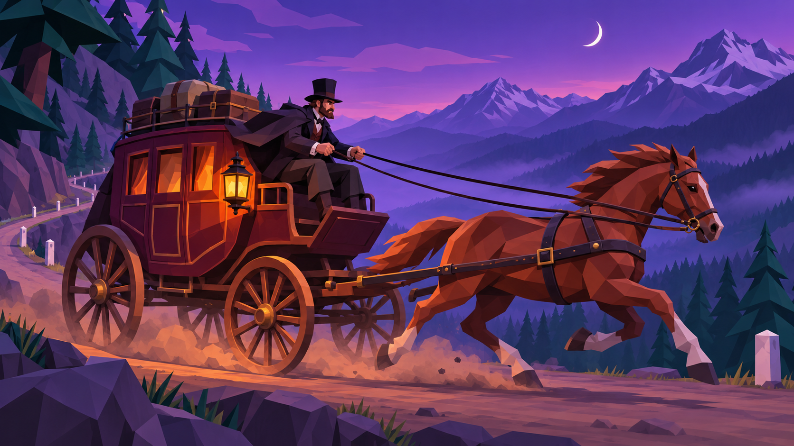
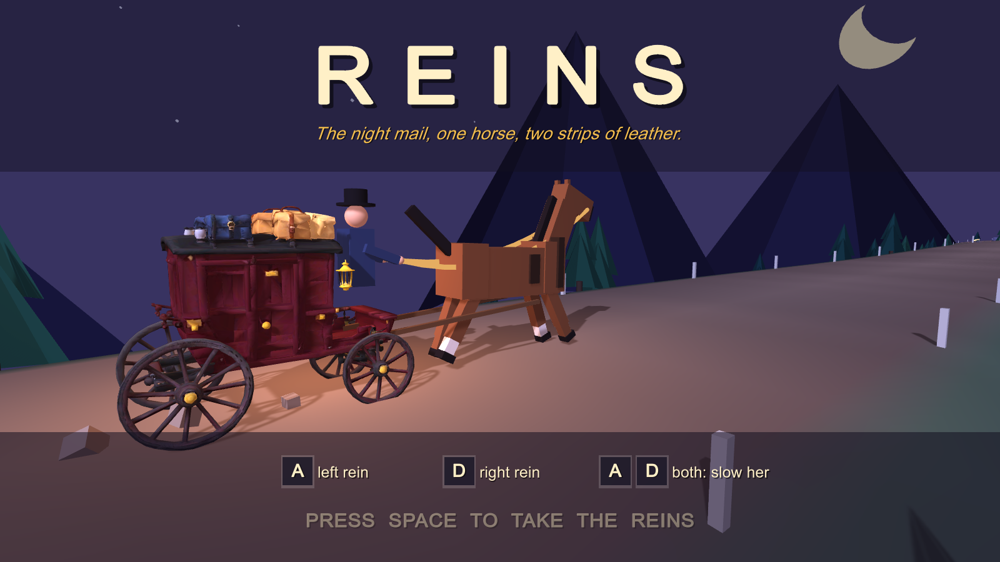
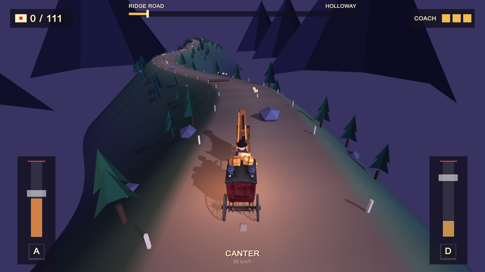
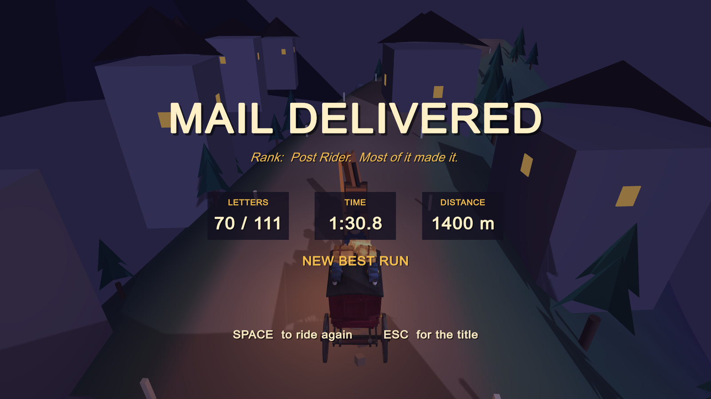
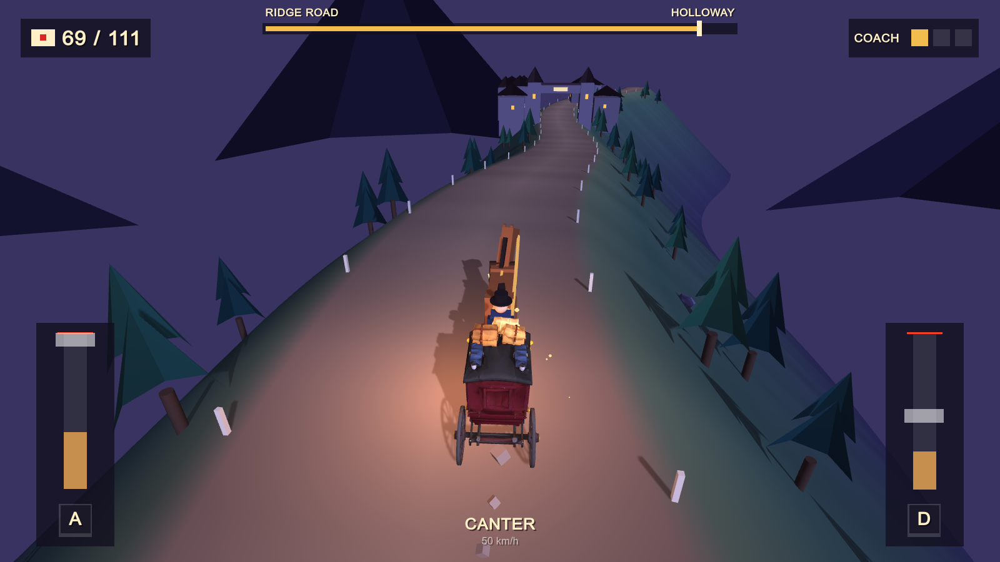

# Reins

**The night mail, one horse, two strips of leather.**



Reins is a short arcade driving game about not really being in control. You are the driver of a
mail coach on a mountain ridge at dusk. You cannot steer and you have no brake. You have a left
rein and a right rein, a horse with her own ideas, and 1.4 km of road between you and the town of
Holloway.



## How it plays

| Input | What it does |
| --- | --- |
| `A` / `←` / left mouse | Pull the **left rein** — her head comes round and she turns left |
| `D` / `→` / right mouse | Pull the **right rein** — she turns right |
| Both together | Rein her in — she slows towards a walk |
| Neither | Slack reins — she follows the road loosely and builds to a gallop |
| `R` | Restart the run |
| `Esc` | Back to the title |

The whole game hangs on one rule: **reins wear out when you lean on them.**

Every second a rein is held it builds *strain*, and it builds four times faster at a gallop than
at a walk. Let go and it recovers. Hold on too long and it **snaps** — that side goes dead for
four seconds while you knot it back together, which means you can only turn one way and you
cannot slow down at all.

So the two things you want most (to slow down and to turn hard) are the two things that cost
you, and the cheap option (let her run) is the one that gets you killed. A good run is a series
of short, light corrections, with the horse doing most of the work.



### On the road

- **Letters** — ribbons of mail on the far side of every hazard. Collect them; they are your score.
- **Boulders and fallen logs** — hitting one costs the coach one of its three knocks, kills your
  speed and spills two letters back onto the road.
- **Crow trees** — dead trees with crows roosting in them. Pass one and the flock goes up, the
  horse shies away from that side and **bolts**: faster than a gallop, half as willing to slow.
- **The verge** — past the white marker posts the ground is rough and slow, and she will try to
  edge back onto the road by herself. Haul her further out anyway and it is not ground any more.
- **The pinch** — in the back half the ridge narrows, right when the hazards get closer together.

Reach the gatehouse at Holloway and you are ranked on letters delivered and the state of the coach.
A clean run takes about a minute and a half. Your best delivery (most letters, time as the
tie-break) is kept between sessions and shown on the title screen.





## Running it

**Just want to play?** Download the Windows build from the
[latest release](https://github.com/alexandrerh/Reins/releases/latest), extract it and run
`Reins.exe`.

To open the project you need **Unity 6000.6.9f1** (Unity 6.6). No packages beyond the built-in
modules.

1. Clone the repo and open the folder in Unity Hub.
2. Open `Assets/Scenes/Main.unity` and press Play.

To make a standalone Windows build use **Reins ▸ Build Windows Player** in the editor menu, or
headless:

```
Unity.exe -batchmode -quit -projectPath . -executeMethod Reins.EditorTools.ProjectSetup.BuildWindows
```

The player lands in `Build/Reins.exe`.

## How it is put together

The scene holds a single `GameManager`. Everything else — the ridge, the trees, the horse, the
HUD, the sound — is built in code when the scene loads, so the project is almost entirely
scripts and diffs stay readable.

```
Assets/
  Scripts/
    GameManager.cs   Run flow (title / run / result), input, scoring, chase camera
    Rig.cs           The horse and coach: rein-driven movement, collisions, animation
    Rein.cs          Pull, strain, snapping and re-knotting for one rein
    Track.cs         The course as a function of distance, plus mesh, scenery and hazards
    Autopilot.cs     A driver that uses the same two inputs as the player
    Hud.cs           Rein gauges, progress, results
    Sfx.cs           Synthesised audio (no audio files in the project)
    Fx.cs            One pool of cubes for dust, debris, letters and crows
    Build.cs         Primitive/mesh/material helpers
  Resources/
    ReinsLit.shader  Flat lambert + shadows + fog + the coach lantern
    ReinsGlow.shader Unlit, fog-free colour for moon, windows, letters, reins
    Models/          The stagecoach mesh and its albedo map
  Editor/
    ProjectSetup.cs  Scene regeneration and player builds
Tools/
  prepare_model.py   Blender script that turns a raw generated model into a game asset
```

A few decisions worth explaining:

**The road is a function, not a mesh.** `Track` exposes `CenterX(z)`, `Height(z)` and
`HalfWidth(z)`, and everything derives from those: the rendered ridge, where a boulder sits,
whether the coach is on the verge, what the autopilot aims at. Collision is a handful of
point-to-segment distance checks in the XZ plane, with no physics engine involved, which keeps the
handling deterministic and easy to tune.

**The horse has opinions.** With slack reins she steers herself towards the road's direction (not
its centre), wanders slowly, and follows the road less faithfully the faster she goes. The player
is correcting an animal, not driving a car, and most of the feel comes from three numbers in
`Rig.Tick`.

**The coach is towed.** It keeps its own heading and swings round a beat after the horse, so the
back end can clip a boulder the horse cleared. Both are tested against hazards separately.

**An autopilot that plays fair.** `Autopilot` can only hold or drop each rein, same as the player.
It drives the attract mode behind the title, and running the build with
`-autoshot <folder>` has it play a run and save screenshots, which is how the images in this
README were captured and how the course gets a quick smoke test after tuning changes.

**One lantern, no light components.** The coach lantern is a global shader vector rather than a
Unity light. Every surface adds a warm falloff term around that point, which gives the pool of
light around the coach for the cost of a few instructions in one shader.

**Sound without files.** Hooves, the post horn, the rein snap, crows and wind are generated into
`AudioClip`s at startup. Letter pickups climb a pentatonic scale while a streak holds.

## Assets

The stagecoach was generated in [Tripo](https://www.tripo3d.ai/) from a text prompt, then run
through `Tools/prepare_model.py` in Blender, which welds and decimates it from roughly 1.9 million
triangles to 18 thousand, normalises scale and origin, and writes it out with a 1k albedo map.
Everything else in the game is built from primitives and generated meshes in code.

The cover illustration at the top of this page was generated with ChatGPT's image model. The other
images are unedited captures from the game.

Development was AI-assisted (Claude Code).

## Tuning

Most of the numbers that matter are constants at the top of two files:

- `Rein.cs` — strain rates at walk and gallop, recovery rate, knot time.
- `Rig.cs` — top speed, turn rate, fall margin, how many knocks the coach takes.

The course layout is seeded (`GameManager.CourseSeed`), so the ridge is the same every run and can
be learned.

## Roadmap

- Gamepad triggers as analogue reins, so a half-pull is possible.
- A second horse, with one rein each.
- Ghost of your best run.
- Weather on the ridge: rain shortens rein life, wind pushes the coach.

## License

See [LICENSE](LICENSE).
